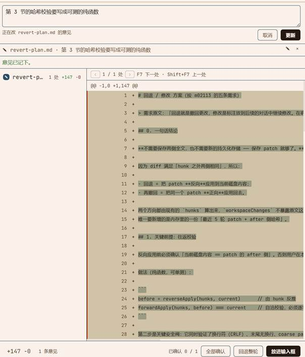

# dsh-diff-review

English | [中文](README.zh.md)

A review pane for DSH: read a turn's diffs one file at a time, confirm each file separately, revert a file (or the whole turn) back to how it was before, and leave review notes for the next turn.

DSH already ships a read-only change viewer. This plugin is the other half — the one that writes.



## Contents

- [What it does](#what-it-does)
- [Install](#install)
- [Use it](#use-it)
- [How it avoids clobbering your work](#how-it-avoids-clobbering-your-work)
- [Files it creates](#files-it-creates)
- [Appearance: font, size, colour](#appearance-font-size-colour)
- [Development](#development)
- [Design notes](#design-notes)
- [Limitations](#limitations)
- [License](#license)

## What it does

| Action | Scope | Touches disk |
| --- | --- | --- |
| Confirm | one file / whole turn | no — records a decision only |
| Revert | one file / whole turn | yes — writes the file back |
| Undo revert | one file / whole turn | yes — writes the change forward again |
| Edit (note) | one file | no — becomes text in the composer |

Everything else is reading: the turn list, the file list, per-file hunks with word-level highlighting, and the decision state. A turn that changed nothing and a turn still running are shown as different things, so the pane never sits on "still running" forever.

Reverting a turn is streamed: the Host plans every file first (read-only), then writes them one by one and reports progress per file. A file that cannot be planned is reported and skipped instead of aborting the batch.

## Install

The plugin is a normal DSH bundle. It is not on npm yet, so install it from a checkout.

```bash
git clone https://github.com/pastchais/dsh-diff-review.git
cd dsh-diff-review
```

Then, from the DSH Web UI, open **Plugins → install a bundle** and point it at the checkout:

```
link:<absolute path to the checkout>
```

Or from an agent session with `plugin_manager` enabled:

```
plugin_manager(action: "install_bundle", target: "link:<absolute path to the checkout>")
```

The install enables the bundle by default. With HMR configured in the profile, the browser half reloads on `ctrl+r`; without it, restart DSH.

If you would rather run it from source without installing, point HMR at the checkout instead — this is what the development setup uses:

```yaml
# <dshHome>/cordis.hmr.patch.yml
- id: hmr
  name: '@deepseek-ai/dsh-hmr'
  config:
    base: file:///<absolute path to the checkout>
    root: ['.']
    debounce: 100
```

Requirements: a DSH profile with the Web UI. The pane registers into the right Sidebar, so `@deepseek-ai/dsh-client-ui-sidebar-right` must be present (it is, in every shipped Web profile). Nothing else is mandatory — see [Limitations](#limitations) for what degrades when a service is missing.

## Use it

**Open the pane.** Each finished turn with recorded changes ends with an "Review in sidebar" button; the pane also appears as a **Change review** tab in the right Sidebar.

**Pick a turn.** The header has a turn picker offering the newest recorded turns. It remembers the *turn number*, not a position, so new turns arriving at the top do not change what you are looking at.

**Walk the files.** `↑` / `↓` move through the file list, `Enter` confirms the selected file. Each row shows its own `+added −deleted` count, a state dot, and a **new** badge for files the turn created.

**Walk the changes.** `F7` jumps to the next change inside the open file, `Shift+F7` to the previous one. The header shows `1 / N` blocks.

**Act on a file.** The three header buttons work on the file you are looking at:

- **Confirm** records "I have read this". Press again to take the record back.
- **Revert** writes the file back to its pre-turn content, then turns into **Undo revert**.
- **Edit** opens a note box. Saved notes are listed under the diff and can be edited (✎) or dropped (×).

**Finish the turn.** The footer shows `confirmed X / N`, **Confirm all**, **Revert turn**, and — once notes exist — **Send to composer**, which folds every note into one Markdown block and appends it to whatever you already typed, without overwriting it.

## How it avoids clobbering your work

Reverting is the only destructive action, and it is guarded three ways.

**Round-trip check.** A revert is computed as "apply the turn's patch backwards". Before writing, the result is pushed forward again and compared byte for byte with what is on disk:

```
before = reverseApply(hunks, current)
forwardApply(hunks, before) === current     // must hold, or nothing is written
```

This one check covers CRLF, a missing trailing newline, and coarse patches that degraded to "replace the whole file" — the three cases where a naive reverse-apply silently corrupts a file.

**Optimistic locking.** The write goes through the filesystem with `replaceIfVersion` using the version observed a moment earlier, or `createIfAbsent` for a file the turn deleted. If anything touched the file in between, the write is refused rather than retried.

**Per-file reporting.** A batch is planned completely before any byte is written, so a refused file leaves the rest untouched. Failures come back as codes (`STALE`, `COARSE`, `UNSUPPORTED`, `MISSING`) that the browser localizes; the Host never sends user-facing prose.

Reverting a file the turn *created* cannot delete it — the filesystem seam has no delete — so it is **emptied** and the UI says so, both in the list ("new") and in the result message.

## Files it creates

| Where | What |
| --- | --- |
| `<dshHome>/storages/diff_review.json` | decisions and review notes, durable across restarts |
| the reviewed files themselves | only when you revert or undo a revert |

Turn snapshots and diffs are **not** stored by this plugin. They come from `@deepseek-ai/dsh-workspace-changes`, which keeps them in memory for the life of the Host process; after a restart the pane offers only the turns that Host can still serve. Decisions and notes survive, because they are in the storage unit above.

## Appearance: font, size, colour

The plugin hard-codes **no colour and no font size**. Everything resolves against the running theme and against DSH's own appearance settings, so "Settings → Appearance" changes it for free and switching light/dark needs no plugin change.

- **Fonts** follow `--dsw-font-family` (prose) and `--ds-font-family-code` (diffs, line numbers).
- **Sizes** follow `--dsh-content-font-delta` / `--dsh-code-font-delta`, the deltas DSH puts on `body` when you change the text or code size.
- **Colours** are `var(--dsw-alias-*)` tokens only, including `--dsw-alias-file-diff-*` for the diff bands.

Three ways to change it, lightest first:

1. Install a theme plugin, or override `--dsw-alias-*` in your profile. This pane follows.
2. Add a CSS override — every rule is scoped under `.dr-root`:

   ```css
   .dr-root .dr-line[data-k=add] { background: #e8f5e9; }
   ```

3. Edit the `const CSS` array in `lib/client.js`; with HMR a `ctrl+r` is enough.

Word-level highlighting uses `color-mix()` over the theme's marker colours, because the theme has no per-word token. The percentage is one number if you want it louder or quieter.

See [docs/appearance.md](docs/appearance.md) for the full table of tokens, the current size scale, and a checklist for verifying that nothing is hard-coded.

## Development

```
lib/index.js            Host half: 12 authenticated routes, decision + note store, revert
lib/patch.js            pure patch math: reverseApply / forwardApply / round-trips
lib/client.js           browser half: tab, turn picker, diff view, notes, composer hand-off
test/patch.mjs          patch math against real structuredPatch output (14 cases)
test/host-contract.mjs  routes, refusals, streaming, sandbox policy, storage shape
test/client-contract.mjs rendering contract, dictionaries, pure helpers
docs/                   appearance and the revert design note
```

```bash
npm test          # all three suites, no dependencies to install
```

The tests are contract tests: they drive the plugin's own exports against hand-written doubles for the Host services, so they run in plain Node with no build step and no DSH running. The patch math is tested separately against real `structuredPatch` output, because that is the part that can corrupt a file.

The Host half imports nothing but `./patch.js` — a plugin installed into a profile cannot resolve `@deepseek-ai/dsh-*` packages, so the storage domain spec and its record schemas are declared by hand.

## Design notes

[`docs/revert-plan.md`](docs/revert-plan.md) is the design note behind the revert and note features, including the parts that changed while building it and the mistakes worth not repeating:

- `AbortSignal.any` rejects an `undefined` entry, so a recorder read without a signal throws.
- `@deepseek-ai/dsh-fs-sandbox` falls back to the *deployment* policy when none is passed, which is narrower than the Session's — a revert must pass `sandboxPolicy.resolve({ session })` or it is denied.
- The storage unit is in `single` layout, where `compatibleVersions` does not apply: adding a table is safe, bumping the version orphans every existing record.
- `ctx.fs` has no delete, which is why a created file is emptied rather than removed.

## Limitations

- **In-memory turn records.** The Host keeps snapshots in memory; after a restart, older turns are gone from the picker rather than shown as broken.
- **One layout.** Unified diffs only, with a fixed 3 lines of context, as recorded by the Host.
- **No deletes.** Reverting a created file empties it; removing the file is yours to do.
- **Degrades, never crashes.** Without `storageDomain` the pane reads but cannot record (503). Without `fs` it reads and records but cannot revert. Without `sessions` the turn picker and latest-turn detection stop. Without `conversation` the "send to composer" button stops. The diff itself needs `workspaceChanges`; without it the pane shows its empty state.

## License

MIT — see [LICENSE](LICENSE).
